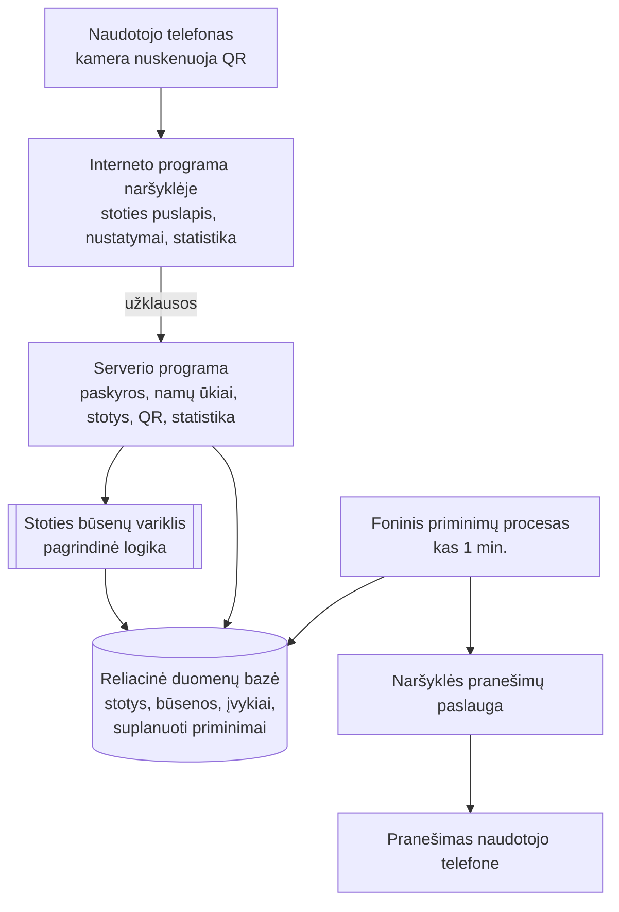

# Namų ruošos darbų sekimo sistema su QR kodais (ROOMAPP)

Kursinio darbo I dalis: projektavimo dokumentas

## 1. Problema ir idėja

**Sistema vienu sakiniu:** Interneto programa bendrai gyvenantiems žmonėms: ant kiekvieno buitinio prietaiso ar darbo vietos (skalbimo mašina, indaplovė, šiukšlių dėžė, augalas) priklijuojamas QR kodas, jį nuskenavus vienu paspaudimu pažymima nauja būsena („Skalbia“, „Iškrauta“), o pasibaigus nustatytam laikui sistema praneša atsakingam žmogui.

**Problema ir dabartinis procesas:** Bendrai gyvenantys žmonės apie buities darbus dabar susirašinėja grupiniame pokalbyje („kieno skalbiniai mašinoje?“), naudoja lapelį ant šaldytuvo arba pasikliauja atmintimi. Niekas nežino dabartinės prietaiso būsenos, todėl išskalbti skalbiniai valandų valandas lieka mašinoje; paleidęs skalbimą žmogus pamiršta grįžti, nes niekas nepriminė; istorijos nėra, todėl ginčai „kas daugiau daro“ remiasi įspūdžiais. Esamas užduočių programėles reikia įdiegti ir jose ieškoti užduoties, todėl jomis greitai nustojama naudotis.

**Nauda:** Nuskenavęs QR kodą gyventojas iš karto mato prietaiso būseną, kas ir kada ją nustatė, o veiksmą užregistruoja per kelias sekundes be programėlės diegimo. Laikmatis automatiškai primena („Skalbimas baigtas – iškrauk“), o istorija ir statistika leidžia objektyviai matyti darbų pasiskirstymą.

**Naudotojai:**
- *Namų ūkio savininkas* – sukuria namų ūkį, pakviečia narius, sukuria stotis (prietaisus), apibrėžia jų būsenų ciklą ir laikmačius, atsispausdina QR kodus.
- *Namų ūkio narys* – nuskenuoja QR kodą, pakeičia stoties būseną, prireikus atšaukia klaidingą veiksmą, gauna pranešimus, peržiūri istoriją ir statistiką.

**Prielaidos:**
- Žinoma: telefonų kamera atpažįsta QR kodą su nuoroda ir atidaro ją naršyklėje be programėlės; „iOS“ naršyklės pranešimai veikia tik svetainę pridėjus prie pradžios ekrano.
- Prielaida: namų ūkį sudaro 2–6 žmonės su išmaniaisiais telefonais; per parą atliekama iki 50 skenavimų, o tą pačią stotį vienu metu gali skenuoti keli žmonės.
- Prielaida: pakanka slapyvardžio ir slaptažodžio, el. pašto nereikia; kiekvienas namų ūkis pats nusistato stočių būsenų ciklus ir laikmačius.

## 2. Apimtis

| Funkcija | Ką naudotojas galės atlikti | Pagrindinis modulis ar pagalbinė funkcija |
|---|---|---|
| Stoties būsenos keitimas (skenavimas → perėjimas → laikmatis → atšaukimas) | Nuskenavęs QR kodą, vienu mygtuku perkelia stotį į kitą ciklo būseną; sistema patikrina konfliktus, suplanuoja priminimą, leidžia per 60 s atšaukti klaidą | **Pagrindinis modulis** |
| Stočių ir būsenų ciklų konfigūravimas, QR kodai | Sukuria stotį, apibrėžia būsenų ciklą ir laikmačius, atsisiunčia ir atsispausdina QR kodą | Pagalbinė |
| Pranešimai apie suveikusius laikmačius | Leidžia naršyklei rodyti pranešimus ir gauna priminimą, kai baigiasi laikmatis | Pagalbinė |
| Namų ūkis ir paskyros | Užsiregistruoja su slapyvardžiu ir slaptažodžiu, sukuria namų ūkį arba prisijungia prie jo kvietimo kodu | Pagalbinė |
| Istorija ir statistika | Mato stoties ir namų ūkio įvykių istoriją, kiekvieno nario atliktų veiksmų skaičių ir dalį per savaitę | Pagalbinė |

**Į kursinio darbo apimtį neįeina:** el. paštas ir slaptažodžio atkūrimas el. paštu; naudotojo narystė keliuose namų ūkiuose; priminimai „nedaryta X dienų“; darbų rotacija („kieno eilė“); stočių šablonai; QR skaitytuvas programos viduje ir NFC žymos; realaus laiko sinchronizacija tarp telefonų (pakanka puslapio atnaujinimo); išlaidų sekimas, čekių atpažinimas, maisto atsargų apskaita; vietinės mobiliosios programėlės; išplėstinė statistika (šilumos žemėlapiai, serijos).

## 3. Pagrindinis modulis

**Pavadinimas ir atsakomybė:** *Stoties būsenų variklis.* Jis nusprendžia, ar konkretus naudotojas gali pakeisti stoties būseną, apskaičiuoja naują būseną, užtikrina, kad vienu metu atlikti skenavimai nesugadintų duomenų, suplanuoja ir atšaukia laikmačių priminimus bei valdo veiksmo atšaukimą.

**Logika, kurią reikės projektuoti ir testuoti:** būsenų ciklo teisingumo tikrinimas, perėjimo ir prieigos taisyklės, vienu metu atliktų pakeitimų konfliktų sprendimas (kiekviena stotis turi pakeitimų numerį, kuris didėja po kiekvieno pakeitimo), priminimų laiko ir gavėjų apskaičiavimas bei atšaukimo taisyklės. Variklis bus atskirtas nuo naudotojo sąsajos, serverio sąsajos ir duomenų saugyklos: jis gauna stoties būseną, naudotojo komandą ir laiką, o grąžina sprendimą. Todėl jo taisykles galima testuoti atskirai, ir jos nepriklauso nuo galutinio technologijų pasirinkimo.

**Įvestis:**
- Perėjimo komanda: kuri stotis (pagal QR kodą), kuris naudotojas, kokį stoties pakeitimų numerį naudotojas matė atidaręs puslapį, ir veiksmo laikas.
  Pavyzdys: Ona 10:00:00 nuskenavo skalbimo mašinos kodą; jos ekrane buvo rodoma būsena „Prikrauta“ ir 7-as pakeitimas.
- Atšaukimo komanda: kuris veiksmas atšaukiamas, kas atšaukia, kada.
  Pavyzdys: Jonas 12:00:40 atšaukia savo 12:00:00 atliktą veiksmą.
- Stoties nustatymai: pavadinimas, būsenų ciklas, laikmačiai (pavyzdys – žr. scenarijų aprašą žemiau).

**Išvestis:**
- Sėkmės atveju: nauja būsena, naujas pakeitimų numeris, užregistruotas įvykis (kas, kada, iš kurios į kurią būseną), suplanuoti ir atšaukti priminimai.
  Pavyzdys: būsena „Skalbia“, 8-as pakeitimas, įvykis „Ona: Prikrauta → Skalbia, 10:00:00“, priminimas Onai 11:30:00.
- Atmetimo atveju: priežastis ir dabartinė stoties būsena.
  Pavyzdys: „Būseną jau pakeitė Ona 10:45:12 – dabar „Iškrauta“.“

**Veikimo eiga:** randama stotis ir patikrinama prieiga (taisyklė 2) → nustatoma kita ciklo būsena ir patikrinamas pakeitimų numeris (3) → viena nedaloma operacija pakeičiama būsena, užregistruojamas įvykis, atšaukiami seni ir suplanuojami nauji priminimai (4–5) → naudotojui grąžinama nauja būsena, o foninis procesas vėliau išsiunčia priminimus.

### Taisyklės arba sprendimo žingsniai

1. **Ciklo teisingumas.** Stotis turi turėti nuo 2 iki 10 būsenų; kiekviena būsena turi lygiai vieną kitą būseną; einant iš būsenos į būseną turi būti aplankytos visos ir grįžtama į pradinę (uždaras ciklas). Laikmačio trukmė – nuo 1 min. iki 24 val. Pažeidus taisyklę stotis neišsaugoma ir naudotojui nurodoma klaidos priežastis.
2. **Prieiga.** Būseną keisti gali tik stoties namų ūkio narys. Nežinomas QR kodas – „stotis nerasta“; ne narys – „prieiga draudžiama“; būsena nekeičiama.
3. **Perėjimas.** Nauja būsena visada yra kita būsena cikle (vienas mygtukas, be pasirinkimo). Perėjimas atliekamas tik tada, kai naudotojo matytas pakeitimų numeris sutampa su dabartiniu; po sėkmės numeris padidinamas vienetu. Nesutapus – konfliktas, įvykis neregistruojamas, naudotojui parodoma dabartinė būsena.
4. **Priminimo planavimas.** Kiekvienam naujos būsenos laikmačiui suplanuojamas priminimas: siuntimo laikas = įvykio laikas + laikmačio trukmė. Gavėjas – arba veiksmą atlikęs žmogus, arba visi namų ūkio nariai (pagal laikmačio nustatymą).
5. **Nebeaktualių priminimų atšaukimas.** Kai stotis išeina iš būsenos, visi tos stoties dar neišsiųsti priminimai atšaukiami (pvz., skalbiniai iškrauti anksčiau – priminimo nebereikia).
6. **Atšaukimas.** Leidžiamas tik tada, kai: (a) veiksmas yra paskutinis neatšauktas stoties veiksmas, (b) nuo jo praėjo ne daugiau kaip 60 s, (c) atšaukia tas pats žmogus arba namų ūkio savininkas. Rezultatas: stotis grąžinama į ankstesnę būseną, pakeitimų numeris padidinamas, veiksmas pažymimas kaip atšauktas, jo suplanuoti priminimai atšaukiami. Anksčiau atšaukti priminimai neatkuriami (supaprastinimas).
7. **Statistika** skaičiuojama tik iš neatšauktų veiksmų.

### Scenarijai būsimiems testams

Visuose scenarijuose naudojama stotis „Skalbimo mašina“, ciklas „Prikrauta → Skalbia → Iškrauta → Prikrauta“, būsenai „Skalbia“ – 90 min. laikmatis, priminimas veiksmą atlikusiam žmogui. Namų ūkio nariai: Ona (savininkė) ir Jonas.

| Scenarijus | Pradinės sąlygos ir konkreti įvestis | Veiksmas | Tikslus laukiamas rezultatas |
|---|---|---|---|
| Įprastas atvejis | Būsena „Prikrauta“, 7-as pakeitimas, suplanuotų priminimų nėra | Ona 10:00:00 paspaudžia „Skalbia“, matydama 7-ą pakeitimą | Perėjimas pavyksta; būsena „Skalbia“, 8-as pakeitimas; užregistruotas 1 įvykis „Ona: Prikrauta → Skalbia“; suplanuotas 1 priminimas Onai 11:30:00 |
| Konfliktas | Būsena „Skalbia“, 8-as pakeitimas, suplanuotas priminimas 11:30:00. Ona ir Jonas abu atidarė puslapį matydami 8-ą pakeitimą | 10:45 Ona ir Jonas beveik vienu metu paspaudžia „Iškrauta“ | Onai perėjimas pavyksta: „Iškrauta“, 9-as pakeitimas. Jonui – konfliktas, jam rodoma „Būseną jau pakeitė Ona“. Užregistruotas tik 1 įvykis; priminimas 11:30:00 atšauktas |
| Klaida: atšaukimo laikas baigėsi | Jonas 12:00:00 per klaidą paspaudė „Prikrauta“ (būsena „Iškrauta → Prikrauta“), 10-as pakeitimas | Jonas 12:01:05 bando atšaukti šį veiksmą | Atmetama: „Atšaukti galima tik per 60 s“; būsena „Prikrauta“ ir 10-as pakeitimas nepasikeitę (jei būtų bandęs 12:00:40 – atšaukimas pavyktų, būsena vėl „Iškrauta“) |
| Klaida: neteisingas ciklas | Kuriama stotis su būsenomis A, B, C, kur po A eina B, po B vėl B, o C nepasiekiama | Savininkas bando išsaugoti stotį | Atmetama: „Būsenų ciklas neuždaras“; stotis nesukuriama |

**Jei modulis naudoja AI:** Netaikoma.

## 4. Kokybės atributas

**Pasirinktas atributas:** Patikimumas (duomenų vientisumas, kai keli naudotojai vienu metu keičia tą pačią stotį).

**Kodėl svarbus šiai sistemai:** Tą patį fizinį prietaisą naudoja keli žmonės, todėl du žmonės dažnai nuskenuoja tą patį QR kodą vienu metu. Jei būtų įvykdyti abu perėjimai, stotis „peršoktų“ būseną, atsirastų klaidingi priminimai ir neteisinga statistika – sistema nebeparodytų tikrosios būsenos.

**Tikrinimo scenarijus ir sąlygos:** Vietinė, dokumentuota testavimo aplinka (serveris ir duomenų bazė viename kompiuteryje). Stotis, kurios naujoje būsenoje yra laikmatis. Tuo pat metu siunčiama 50 perėjimo užklausų nuo 5 skirtingų naudotojų, visos su tuo pačiu matytu pakeitimų numeriu. Bandymas kartojamas 20 kartų.

**Sėkmės kriterijus:** Kiekviename iš 20 bandymų: lygiai 1 užklausa pavyksta, likusios 49 gauna konfliktą; įvykių padaugėja lygiai vienu; pakeitimų numeris padidėja lygiai vienetu; suplanuotų priminimų padaugėja tiek, kiek naujoje būsenoje yra laikmačių. Per 20 bandymų – nė vieno nukrypimo.

**Numatytas projektavimo sprendimas:** Optimistinis užraktas: kiekviena stotis turi pakeitimų numerį, o būsena pakeičiama tik su sąlyga, kad numeris nepasikeitė nuo to momento, kai naudotojas atidarė puslapį. Būsenos pakeitimas, įvykio registravimas ir priminimų planavimas bei atšaukimas atliekami kaip viena nedaloma duomenų bazės operacija (transakcija), todėl dalinis rezultatas neįmanomas.

**Kaip patikrinsiu vėlesniame etape:** Automatinis integracinis testas, kuris vienu metu siunčia 50 užklausų į testinę duomenų bazę, o po to patikrina atsakymus ir įrašų skaičių. Testas bus paleidžiamas automatiškai po kiekvieno pakeitimo repozitorijoje.

**Sprendimo kaina arba ribojimas:** Pralaimėjęs naudotojas gauna konfliktą ir turi dar kartą paspausti mygtuką (sąmoningai nekartojama automatiškai – naudotojas turi pamatyti, kad būsena jau pasikeitė). Pakeitimų numerį turi didinti ir nustatymų keitimas, tai reikia nuosekliai įgyvendinti visose funkcijose.

## 5. Pradinė sistemos struktūra

### Paprasta schema

| Sistemos dalis | Atsakomybė |
|---|---|
| Interneto programa naršyklėje | Stoties puslapis su vienu „kitos būsenos“ mygtuku ir atšaukimu, stočių ir ciklų nustatymai, QR lipdukų lapas, istorija ir statistika; kartu su perėjimu siunčia matytą pakeitimų numerį. Gali būti įdiegiama telefono pradžios ekrane ir priimti pranešimus |
| Serverio programa | Paskyros ir prisijungimas, namų ūkių ir stočių valdymas, QR kodų kūrimas, statistikos skaičiavimas; perėjimų ir atšaukimų užklausas perduoda varikliui |
| Stoties būsenų variklis | Pagrindinio modulio taisyklės 1–7: ciklo tikrinimas, prieiga, perėjimas, konfliktai, priminimų planavimas ir atšaukimas, veiksmo atšaukimas |
| Reliacinė duomenų bazė | Naudotojai, namų ūkiai, narystės, stotys su pakeitimų numeriu, būsenos, laikmačiai, įvykiai, suplanuoti priminimai, pranešimų prenumeratos |
| Foninis priminimų procesas | Kas minutę paima suėjusius priminimus, juos išsiunčia per naršyklės pranešimų paslaugą ir pažymi kaip išsiųstus |

**Planuojamos technologijos ir pasirinkimo priežastys:** Technologijos dar gali keistis, todėl svarbiausia – reikalavimai joms: reliacinė duomenų bazė su transakcijomis (būtina optimistiniam užraktui ir nedalomoms operacijoms), interneto programa, kurią galima įdiegti telefono pradžios ekrane ir gauti pranešimus be programėlių parduotuvės, bibliotekos QR kodams ir naršyklės pranešimams, galimybė pagrindinį modulį testuoti atskirai, HTTPS talpinimas. Preliminarus pasirinkimas – „JavaScript“ ekosistema (React naudotojo sąsajai, Node.js serveriui) ir PostgreSQL, nes su jomis jau turiu patirties ankstesniame projekte. Jei pasirinkimas pasikeis, pagrindinio modulio taisyklės ir testų scenarijai liks tie patys.

## 6. AI panaudojimas

### AI rengiant šį dokumentą

AI naudotas.

| Priemonė ir užduotis | Ką panaudojau | Ką atmečiau arba perrašiau ir kodėl | Kaip patikrinau |
|---|---|---|---|
| Claude (Anthropic) – pradinio produkto plano struktūrizavimas (duomenų modelis, technologijos, rizikos) | Duomenų modelio esybių sąrašą, optimistinio užrakto ir duomenų bazėje laikomų laikmačių idėjas | Atmečiau v2/v3 idėjas (išlaidų sekimas, čekių atpažinimas su AI, NFC, rotacija) – per plati kursinio darbo apimtis | Sprendimus sutikrinau su naršyklės pranešimų ir optimistinio užrakto aprašymais (žr. šaltinius) |
| Claude – plano palyginimas su užduoties reikalavimais ir šio dokumento juodraštis pagal šabloną | Pagrindinio modulio taisyklių formuluotes, testų scenarijų struktūrą, kokybės atributų formuluotes | Apimtį sumažinau iki 5 funkcijų, o dokumentą – iki rekomenduojamos apimties; pridėjau taisyklę dėl nebeaktualių priminimų atšaukimo; kodo pavyzdžius pakeičiau aprašymais žodžiais, nes technologijos dar gali keistis | Kiekvieną taisyklę ir scenarijų peržiūrėjau ir „ranka“ perėjau su pavyzdine stotimi; patikrinau, kad scenarijų pakeitimų numeriai ir laikai tarpusavyje sutampa |

### Planuojamas AI naudojimas kuriant sistemą

**Kur ir kam naudosiu AI:** Kodo rašymo asistentas – karkaso kodui generuoti, testų atvejų idėjoms, klaidų paieškai ir statistikos užklausoms.

**Kaip tikrinsiu pasiūlymus ir sugeneruotą kodą:** Pagrindinio modulio taisykles pirmiausia aprašau testais (3 skyriaus scenarijai); AI pasiūlytas kodas priimamas tik praėjus testams ir mano peržiūrai. Vienu metu vykstančių veiksmų logiką tikrinu integraciniu testu, nes AI dažnai pasiūlo „pirma patikrink, paskui atnaujink“ sprendimą, kuris nėra nedalomas. Rizikos: nepastebėtos lenktynių sąlygos, pasenusios bibliotekos, nesuprantamas kodas – tokio kodo nepriimu, kol negaliu jo paaiškinti.

**Ar AI bus sistemos funkcionalumo dalis:** Ne.

## 7. Tolesnių darbų planas

| Darbas | Apčiuopiamas rezultatas | Planuojama darbų seka |
|---|---|---|
| Technologijų patvirtinimas ir projekto pagrindas | Galutinai pasirinktos technologijos; repozitorija su duomenų bazės schema, serverio ir sąsajos karkasais, automatiniu testų paleidimu ir HTTPS diegimu | 1 |
| Stoties būsenų variklis ir jo testai | Veikiantis variklis; praeina visi 3 skyriaus scenarijai ir vienu metu atliekamų veiksmų testas (4 skyrius) | 2 |
| Paskyros, namų ūkis, stotys ir QR | Registracija be el. pašto, kvietimo kodas, stoties su ciklu sukūrimas, atsispausdinamas QR, stoties puslapis su mygtuku ir atšaukimu | 3 |
| Laikmačiai ir pranešimai | Foninis priminimų procesas, pranešimų prenumerata, užuomina „iPhone“ naudotojams | 4 |
| Istorija ir statistika, bandymas namuose | Istorijos sąrašas, savaitinė statistika pagal narį; 3 stotys išbandytos realiame bute | 5 |

**Būsimo prototipo veikimo scenarijus:** Sukuriama stotis „Skalbimo mašina“ su ciklu „Prikrauta → Skalbia → Iškrauta“ ir 1 min. laikmačiu būsenai „Skalbia“ (demonstracijai). Ona telefonu nuskenuoja atspausdintą QR kodą ir paspaudžia „Skalbia“ → po 1 min. jos telefone pasirodo pranešimas „Skalbimo mašina: skalbimas baigtas“. Ona ir Jonas vienu metu nuskenuoja kodą ir paspaudžia „Iškrauta“ → vienam perėjimas pavyksta, kitas mato pranešimą „Būseną jau pakeitė Ona“. Jonas per klaidą paspaudžia dar kartą ir per 60 s atšaukia veiksmą. Statistikos puslapyje matyti 2 Onos ir 0 Jono veiksmai (atšauktas veiksmas neįskaitomas).

| Rizika arba neaiškumas | Kaip patikrinsiu arba sumažinsiu |
|---|---|
| Naršyklės pranešimai neveikia arba veikia nepatikimai „iOS“ įrenginiuose | Jau pirmoje savaitėje padarysiu minimalų bandomąjį puslapį su vienu pranešimu ir išbandysiu „iPhone“ ir „Android“ telefonuose per HTTPS; atsarginis sprendimas – stoties puslapyje visada rodomas laikas nuo paskutinio pakeitimo |
| Pasirinktos technologijos neleis paprastai užtikrinti nedalomo būsenos pakeitimo | Vienu metu atliekamų veiksmų testą (4 skyrius) parašysiu dar prieš kurdamas sąsają; jei pasirinktas įrankis to neužtikrins, naudosiu tiesioginį duomenų bazės užraktą arba kitą įrankį |
| Naudotojai nustos naudotis po pirmų dienų | Bandymas savo bute 2 savaites su 3 stotimis; matuosiu skenavimų skaičių per dieną ir laiką nuo nuskenavimo iki būsenos pakeitimo (tikslas – ne daugiau kaip 5 s) |

## Šaltiniai, jei naudojote

- MDN Web Docs. Push API. https://developer.mozilla.org/en-US/docs/Web/API/Push_API
- WebKit. Web Push for Web Apps on iOS and iPadOS. https://webkit.org/blog/13878/web-push-for-web-apps-on-ios-and-ipados/
- Martin Fowler. Optimistic Offline Lock (Patterns of Enterprise Application Architecture). https://martinfowler.com/eaaCatalog/optimisticOfflineLock.html
